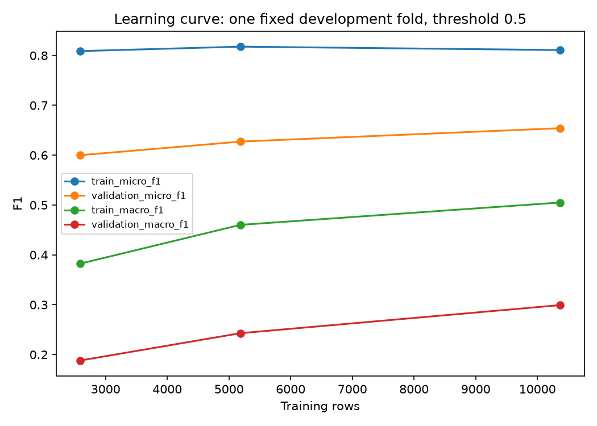

# 🌍 Natural Disaster — Advanced

[🇹🇷 Türkçe](#turkce) | [🇬🇧 English](#english) · [İlk sürüm / Original project](../README.md)

<a id="turkce"></a>

## Bir mesajdan, daha bilinçli bir tahmine.

> “People are trapped after the earthquake. We need water and medical help.”

Bir afet mesajı birden fazla ihtiyacı anlatır. Bu geliştirilmiş sürüm, yalnızca etiket üretmekle kalmaz: **veriyi denetler, modelleri karşılaştırır, kategori eşiklerini seçer ve tahmine katkı sağlayan sözcükleri gösterir.**

**Python · TF–IDF · Logistic Regression · XGBoost · Model karşılaştırması · Yerel web demo**

### İlk sürümden neler değişti?

| Alan | Geliştirilmiş sürüm |
|---|---|
| Veri temizliği | Çelişkili kimlikler/etiketler ve belirsiz `related=2` kayıtları karantinaya alınır |
| Mesaj grupları | Unicode, harf büyüklüğü ve boşluk farklılıkları normalize edilir; olumsuzluk korunur |
| Değerlendirme | Yaklaşık %60 development / %20 validation / %20 test; grup bazlı CV |
| Model seçimi | Dummy, iki Logistic Regression ve sınırlı XGBoost aynı CV bölmelerinde karşılaştırılır |
| Karar eşikleri | Her kategori için yalnız validation verisinde F1 odaklı eşik seçilir |
| Açıklamalar | Doğrusal modelde sözcük katkıları; kategori bazlı hata ve güvenilirlik analizi |
| Deney kaydı | Veri/kod özetleri, paket sürümleri, parametreler ve ayrı koşu klasörleri |
| Kullanım | İngilizce mesaj girişi, kategori/skor/eşik gösteren yerel web demo |

### Kayıtlı deney sonuçları

5 Ekim 2026 tarihli tamamlanmış deneyde model, development CV micro-F1 ile seçildi:

| Model | CV micro-F1 | CV macro-F1 |
|---|---:|---:|
| Dummy | 0,3640 | 0,0248 |
| Logistic Regression C=1 | 0,6124 | 0,2108 |
| **Logistic Regression C=4** | **0,6527** | 0,3040 |
| XGBoost, derinlik 4 | 0,6473 | **0,3582** |

Seçilen Logistic Regression modeli, validation üzerinde dondurulan eşiklerle son testte **micro-F1: 0,6769**, **macro-F1: 0,4756** elde etti. Temiz veri 25.926 mesaj ve öğrenilen çıktı 35 kategoridir. Bu sonuçlar kayıtlı koşuya aittir; paylaşım hazırlığında eğitim yeniden yapılmamıştır. Veri temizliği ve bölme politikası farklı olduğundan ilk sürümün skorlarıyla doğrudan gelişim farkı hesaplanmaz.

[Deney özeti](reports/run_20261005T145652_150141Z/summary.md) · [Ayrıntılı inceleme](reports/REVIEW.md) · [Veri politikası](DATA_POLICY.md)



### Kurulum

Python **3.13** ile kontrol edilen bağımlılıklar `requirements.txt` içindedir. PowerShell'de depo kökünden:

```powershell
cd advanced
python -m venv .venv
.\.venv\Scripts\python.exe -m pip install -r requirements.txt
.\.venv\Scripts\python.exe -m unittest discover -s tests -v
```

Bu akış NLTK ve SQLite gerektirmez. İki kaynak CSV dosyasını **`advanced/data/`** içine yerleştirin:

| Dosya | Beklenen sütunlar |
|---|---|
| `disaster_messages.csv` | `id`, `message`, `original`, `genre` |
| `disaster_categories.csv` | `id`, `categories` |

Ham verinin kaynağı ve yeniden dağıtım koşulları henüz doğrulanmamıştır; CSV dosyaları depoya eklenmez.

### Deney ve demo

```powershell
# Dummy ve iki doğrusal model ile daha kısa deney
.\.venv\Scripts\python.exe src/experiment.py --skip-xgb

# XGBoost dahil tüm adaylarla deney (isteğe bağlı)
.\.venv\Scripts\python.exe src/experiment.py

# Başarıyla kaydedilmiş en son modeli aç
.\.venv\Scripts\python.exe src/demo.py
```

Deney komutlarından birini seçin; her çalıştırma yeni bir koşu oluşturur. Tarayıcıda **http://127.0.0.1:8765** adresini açın. Durdurmak için **Ctrl+C** kullanın. Modeller GitHub'a yüklenmediğinden yeni bir klonda demo için önce bir deney çalıştırılmalıdır. Yerel model paketleri `models/` altında, toplu sonuçlar `reports/` altında tutulur.

### Proje haritası

```text
advanced/
├── README.md
├── requirements.txt
├── .gitignore
├── DATA_POLICY.md
├── src/
│   ├── data_quality.py    # Doğrulama, karantina, mesaj grupları
│   ├── experiment.py      # Model karşılaştırması, eşikler, son test
│   ├── evaluation.py      # Metrikler, grafikler, hata analizi
│   ├── inference.py       # Paket doğrulama ve tahmin
│   ├── demo.py            # Yerel HTTP sunucusu
│   └── demo.html          # Mesaj giriş ekranı
├── tests/
└── reports/               # Paylaşılabilir toplu sonuçlar
```

### Sonuçların sınırları

Skorlar kalibre edilmiş olasılıklar değildir. Eşik seçimi recall'u artırırken precision'ı düşürebilir. Yakın anlamlı mesajlar veya aynı afetin farklı anlatımları ayrı gruplarda kalabilir. Diğer dillerde ve yeni afet olaylarında genelleme ölçülmemiştir; model saha kullanımına hazır bir acil yardım yönlendirme sistemi değildir.

Ham mesajlar, hata/karantina örnekleri, bölme mesaj anahtarları, model paketleri, loglar ve önbellekler Git dışında tutulur. Paylaşılan raporlar geçmiş deneyin toplu sonuçlarıdır; tarihsel kod özetleri bugünkü paketle aynı olduğu iddiasını taşımaz.

---

<a id="english"></a>

## English — From a message to a better-informed prediction.

[🇹🇷 Türkçe](#turkce) | [🇬🇧 English](#english)

> “People are trapped after the earthquake. We need water and medical help.”

A disaster message may describe several needs at once. This advanced version **audits the data, compares models, selects category thresholds and shows words contributing to a prediction.**

**Python · TF–IDF · Logistic Regression · XGBoost · Model comparison · Local web demo**

### What changed?

| Area | Advanced workflow |
|---|---|
| Data cleaning | Quarantine conflicting IDs/labels and ambiguous `related=2` records |
| Message groups | Normalize Unicode, case and whitespace while preserving negation |
| Evaluation | Approximately 60% development / 20% validation / 20% test with grouped CV |
| Model selection | Compare Dummy, two Logistic Regression models and bounded XGBoost on the same CV splits |
| Decision thresholds | Select each label's threshold using validation F1 only |
| Explanations | Word contributions for the linear model; per-label errors and reliability diagnostics |
| Experiment records | Data/code hashes, dependency versions, parameters and separate run directories |
| Interface | Local web demo displaying categories, scores and thresholds |

### Recorded results

The completed run from October 5, 2026 selected a model using development CV micro-F1:

| Model | CV micro-F1 | CV macro-F1 |
|---|---:|---:|
| Dummy | 0.3640 | 0.0248 |
| Logistic Regression C=1 | 0.6124 | 0.2108 |
| **Logistic Regression C=4** | **0.6527** | 0.3040 |
| XGBoost, depth 4 | 0.6473 | **0.3582** |

With thresholds frozen on validation data, the selected Logistic Regression model achieved **test micro-F1: 0.6769** and **macro-F1: 0.4756**. The curated dataset contains 25,926 messages and the model learns 35 categories. These are historical run results; training was not repeated during release preparation. Different cleaning and splitting policies prevent a direct improvement calculation against the original version.

[Run summary](reports/run_20261005T145652_150141Z/summary.md) · [Detailed review, Turkish](reports/REVIEW.md) · [Data policy, Turkish](DATA_POLICY.md)

### Setup

Dependencies were checked with Python **3.13**. From the repository root in PowerShell:

```powershell
cd advanced
python -m venv .venv
.\.venv\Scripts\python.exe -m pip install -r requirements.txt
.\.venv\Scripts\python.exe -m unittest discover -s tests -v
```

This workflow does not require NLTK or SQLite. Place the source CSV files in **`advanced/data/`**:

| File | Expected columns |
|---|---|
| `disaster_messages.csv` | `id`, `message`, `original`, `genre` |
| `disaster_categories.csv` | `id`, `categories` |

The original data source and redistribution terms remain unverified; CSV files are excluded from the repository.

### Experiment and demo

```powershell
# Shorter experiment with Dummy and two linear candidates
.\.venv\Scripts\python.exe src/experiment.py --skip-xgb

# Full candidate set, including XGBoost (optional)
.\.venv\Scripts\python.exe src/experiment.py

# Open the latest successfully saved model
.\.venv\Scripts\python.exe src/demo.py
```

Choose one experiment command; each invocation creates a separate run. Open **http://127.0.0.1:8765** in your browser. Stop the server with **Ctrl+C**. Models are excluded from GitHub, so a fresh clone requires a completed experiment before starting the demo. Local bundles live in `models/` and aggregate results in `reports/`.

`src/data_quality.py` handles curation; `experiment.py` compares models and freezes thresholds; `evaluation.py` produces metrics and charts; `inference.py` validates artifacts and predicts; `demo.py` and `demo.html` provide the interface. Behavioral tests are in `tests/`.

### Limits and sharing

Scores are not calibrated probabilities. Threshold tuning can improve recall at the cost of precision. Similar messages or different accounts of one disaster can remain in separate groups. Generalization to other languages and new disaster events has not been measured. This is a learning project, not a validated emergency response system.

Raw messages, error/quarantine examples, split message keys, model bundles, logs and caches stay outside Git. Published reports contain historical aggregate results; their recorded code hashes are not presented as hashes of the current release.
